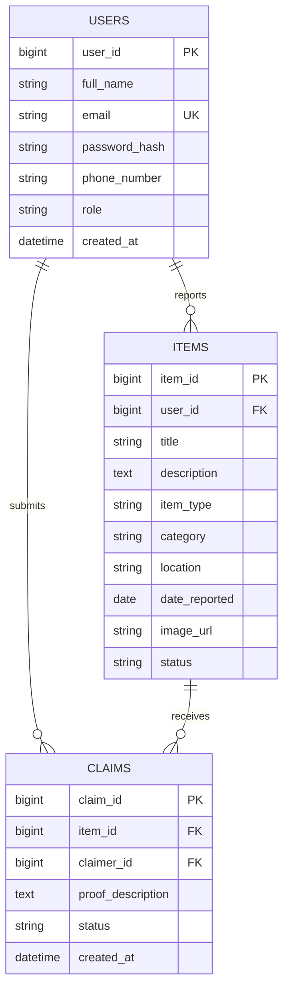

# 🎓 Campus Lost and Found System

A modern, centralized web platform for college campuses that enables students and administrators to report, search, claim, and recover lost belongings quickly and securely.

---

## 📌 Project Abstract

* **Project Title:** Campus Lost and Found System
* **Author:** G SriVidya Reddy
* **Roll No:** 24EG105P29
* **Department:** Computer Science and Engineering (CSE - P)

---

## 🚀 Key Features

* **Authentication & Role-Based Access:**
  * Secure registration and login for students and administrators.
  * Passwords securely hashed with **BCrypt**.
  * Stateless token authentication via **Spring Security & JWT**.
* **Interactive Feeds & Real-Time Filtering:**
  * Separate tabs for **All Items**, **Lost Items**, and **Found Items**.
  * Filter by **Category** (*Electronics, ID Cards, Books, Keys, Other*), **Location**, and **Keywords**.
  * Visual status badges (`ACTIVE` vs `RESOLVED`).
* **Reporting Flow with Photo Uploads:**
  * Post lost or found reports with titles, detailed descriptions, incident dates, and locations.
  * Image upload with live thumbnail preview, stored locally and served statically.
* **Direct Notification & Call-the-Finder Flow (for Lost Items):**
  * When a student spots an item someone lost, they can click **"Found"**.
  * The system notifies the owner immediately and displays the finder's **Full Name** and **Phone Number** with a one-click `📞 Call Finder` button.
* **Ownership Verification & Claim Flow (for Found Items):**
  * Students claiming a found item submit detailed proof of ownership (e.g. wallpapers, stickers, marks, serial numbers).
  * The finder reviews the proof in their dashboard and can **Approve** or **Reject** the claim.
  * Approval automatically updates the item's status to `RESOLVED`.
* **Personal Activity Dashboard (`/profile`):**
  * Manage your reported items.
  * Review received claims and incoming found-item notifications.
  * Track status of your submitted claims (`PENDING`, `APPROVED`, `REJECTED`).

---

## 🛠️ Technology Stack

| Layer | Technologies Used |
| :--- | :--- |
| **Frontend** | React 19, Vite, Tailwind CSS, React Router v7, Axios, Lucide Icons |
| **Backend** | Spring Boot, Spring Security 6, Spring Data JPA, JJWT (0.11.5), Lombok |
| **Database** | MySQL 8.0+ |
| **File Storage** | Local Multipart Storage (`/uploads/`) |
| **Communication** | RESTful APIs (JSON & `multipart/form-data`) |

---

## 🗄️ Database Schema & Entities

The system utilizes three core relational tables:



---

## 📡 REST API Reference

### 1. Authentication (`/api/auth`)
| Method | Endpoint | Description | Auth Required |
| :--- | :--- | :--- | :--- |
| `POST` | `/api/auth/register` | Register new student or admin account | No |
| `POST` | `/api/auth/login` | Login and obtain JWT Bearer token | No |

### 2. Items (`/api/items`)
| Method | Endpoint | Description | Auth Required |
| :--- | :--- | :--- | :--- |
| `GET` | `/api/items` | Search & filter items (`itemType`, `category`, `location`, `search`) | No |
| `GET` | `/api/items/{id}` | Get item details by ID | No |
| `POST` | `/api/items` | Create lost or found report (supports multipart image) | Yes (JWT) |
| `GET` | `/api/items/my-reports` | Get all items reported by current user | Yes (JWT) |
| `PATCH` | `/api/items/{id}/status` | Update item status (`ACTIVE` / `RESOLVED`) | Yes (Owner/Admin) |
| `DELETE`| `/api/items/{id}` | Remove inappropriate or duplicate report | Yes (Owner/Admin) |

### 3. Claims & Found Notifications (`/api/claims`)
| Method | Endpoint | Description | Auth Required |
| :--- | :--- | :--- | :--- |
| `POST` | `/api/claims` | Submit ownership proof OR click "Found" on a lost item | Yes (JWT) |
| `GET` | `/api/claims/my-claims` | Get all claims submitted by current user | Yes (JWT) |
| `GET` | `/api/claims/received` | Get claims and found notifications on user's reports | Yes (JWT) |
| `GET` | `/api/claims/item/{id}` | Get claims for a specific item | Yes (Owner/Admin) |
| `PUT` | `/api/claims/{id}/status` | Approve or reject claim | Yes (Owner/Admin) |

### 4. Users (`/api/users`)
| Method | Endpoint | Description | Auth Required |
| :--- | :--- | :--- | :--- |
| `GET` | `/api/users/profile` | Get current authenticated user profile | Yes (JWT) |
| `GET` | `/api/users` | List all users in system | Yes (Admin only) |

---

## 💻 Getting Started & Installation

### Prerequisites
* **Java:** JDK 17 or JDK 21+
* **Maven:** Apache Maven 3.8+ (or bundled wrapper)
* **Node.js:** v18.0+ & npm
* **MySQL:** MySQL Server 8.0+

---

### Step 1: Database Setup
1. Open your MySQL client (e.g. MySQL Command Line or MySQL Workbench).
2. Create the database:
   ```sql
   CREATE DATABASE IF NOT EXISTS laf;
   ```
3. Update database credentials in `backend/src/main/resources/application.properties` if different:
   ```properties
   spring.datasource.url=jdbc:mysql://localhost:3306/laf?createDatabaseIfNotExist=true&useSSL=false&serverTimezone=UTC
   spring.datasource.username=YOUR_MYSQL_USERNAME
   spring.datasource.password=YOUR_MYSQL_PASSWORD
   ```

---

### Step 2: Run the Spring Boot Backend
1. Navigate to the backend folder:
   ```bash
   cd backend
   ```
2. Build and run the server:
   ```bash
   mvn spring-boot:run
   ```
3. The backend will start on: **`http://localhost:8080/`**

---

### Step 3: Run the React Frontend
1. Open a new terminal and navigate to the frontend folder:
   ```bash
   cd frontend
   ```
2. Install dependencies (if not already installed):
   ```bash
   npm install
   ```
3. Start the Vite development server:
   ```bash
   npm run dev
   ```
4. Access the web interface in your browser:
   * **`http://localhost:5173/`**

---

## 🐳 One-Click Docker Deployment

The system is fully containerized and deploy-ready with Docker Compose:

```bash
docker compose up --build -d
```

* **Frontend & Reverse Proxy:** [http://localhost](http://localhost) (or [http://localhost:3000](http://localhost:3000))
* **Backend API:** [http://localhost:8080](http://localhost:8080)
* **MySQL Database:** `localhost:3306`

👉 **For complete production deployment options (Render, Railway, AWS, Ubuntu VPS), read the [Deployment Guide (DEPLOYMENT.md)](./DEPLOYMENT.md).**

---

## 👥 Demo / Testing Credentials

You can test the system using the pre-registered account or create your own:

| Role | Email | Password |
| :--- | :--- | :--- |
| **Student** | `test@campus.edu` | `password123` |

---

## 📂 Project Structure

```text
LostAndFound/
├── backend/
│   ├── src/main/java/com/campus/lostandfound/
│   │   ├── config/              # WebMvc configuration for image serving
│   │   ├── controller/          # REST Controllers (Auth, Items, Claims, Users)
│   │   ├── dto/                 # Request and Response transfer models
│   │   ├── entity/              # JPA Entities (User, Item, Claim)
│   │   ├── repository/          # Spring Data JPA Repositories
│   │   ├── security/            # Spring Security, JWT Filter, UserDetails
│   │   └── service/             # Business Logic & Validation Services
│   ├── src/main/resources/
│   │   └── application.properties # Dynamic environment-ready config
│   ├── Dockerfile               # Multi-stage JDK/JRE container build
│   └── pom.xml
├── frontend/
│   ├── src/
│   │   ├── pages/               # Dashboard, Login, Register, ReportItem, ItemDetails, Profile
│   │   ├── services/            # Axios API client with JWT interceptor & image helper
│   │   ├── App.jsx              # Main layout & routing configuration
│   │   └── main.jsx
│   ├── nginx.conf               # Production Nginx reverse proxy configuration
│   ├── Dockerfile               # Multi-stage Node/Nginx container build
│   ├── .env.example
│   ├── index.html
│   ├── package.json
│   └── vite.config.js           # Dev proxy for /api and /uploads
├── docker-compose.yml           # Full-stack orchestrator (MySQL + Spring + React + Nginx)
├── DEPLOYMENT.md                # Production guide (Docker, Cloud, VPS)
└── README.md
```

---

## 📜 License & Acknowledgments
Developed for academic presentation and campus utility by **G SriVidya Reddy** (Roll No: `24EG105P29`).
